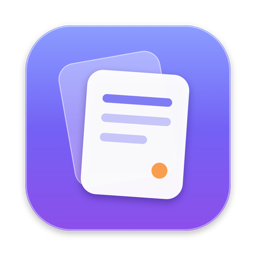
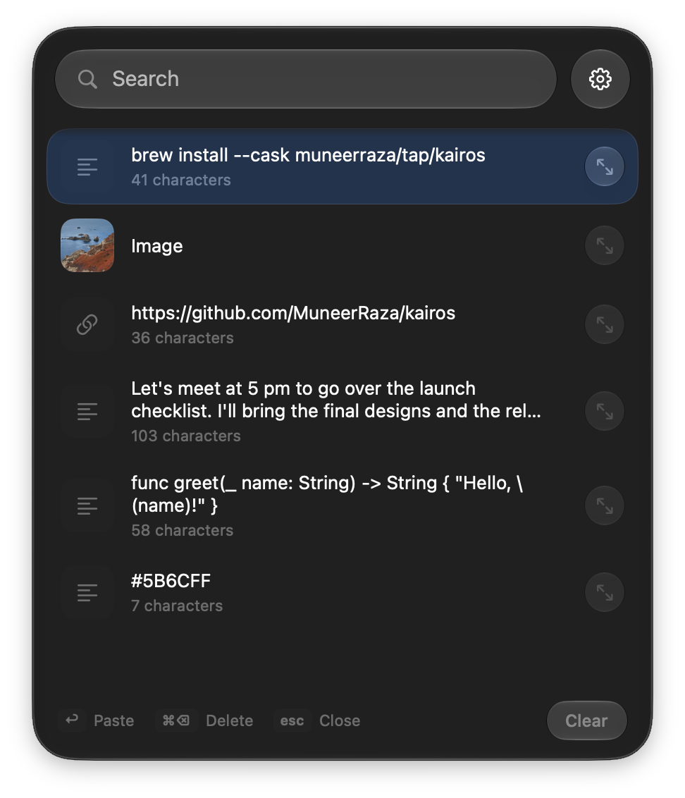

<p align="center">
  
</p>

<h1 align="center">Kairos</h1>

<p align="center">A tiny, native clipboard manager for macOS, built with Liquid Glass.</p>

<p align="center">
  
</p>

## Features

- Press <kbd>⌥</kbd> <kbd>V</kbd> anywhere to open your clipboard history (shortcut is changeable)
- Opens at your mouse pointer, text cursor, or screen center
- Text, links, images, and files
- Search, use the arrow keys, and press <kbd>↩</kbd> to paste straight into the app you're using
- Preview long text and full images
- Skips passwords copied from password managers
- Adjustable history size (30 by default) and start at login
- Native Liquid Glass that follows your system appearance
- Lightweight: about 24 MB of memory, no dependencies

## Install

```bash
brew install --cask muneerraza/tap/kairos
```

Requires macOS 26 Tahoe or later. On first launch, Kairos asks for Accessibility access so it can paste for you.

## Shortcuts

| Key | Action |
|---|---|
| <kbd>⌥</kbd> <kbd>V</kbd> | Open or close Kairos |
| <kbd>↑</kbd> <kbd>↓</kbd> | Move through items |
| <kbd>↩</kbd> | Paste the selected item |
| <kbd>⌘</kbd> <kbd>⌫</kbd> | Delete the selected item |
| <kbd>⌘</kbd> <kbd>,</kbd> | Settings |
| <kbd>esc</kbd> | Close |

## Build from source

```bash
git clone https://github.com/MuneerRaza/kairos.git
cd kairos
./scripts/build.sh
open build/Kairos.app
```

Kairos isn't notarized by Apple. The Homebrew cask handles this for you; if you install the zip by hand, run `xattr -dr com.apple.quarantine /Applications/Kairos.app` once.

## License

MIT
